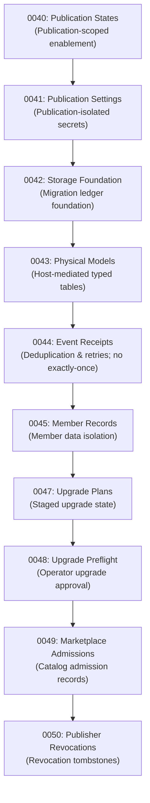

# Plugin Platform — Consumer, Migration, and Runtime Inventory (G0-01)

**Document Version:** 1.0  
**Evidence SHA:** [`f3cc8c4dee53f8fc243207169f08f22e12bb9177`](../../apps/admin/src/components/PageEditor.tsx)  
**Execution Date:** November 5, 2026  
**Status:** **Authoritative Inventory Baseline (G0-01 Complete)**  
**Classification:** Reproducible AST & Grep Scan across `apps/`, `packages/`, `scripts/`, `examples/`, `tests/`

---

## 1. Executive Summary of Inventory Findings

1. **Canonical Runtime Exclusivity**:
   - Every active loader in the runtime fleet ([`trusted-external-plugin-host.ts`](../../packages/domains/plugins/src/application/trusted-external-plugin-host.ts), [`plugin-host.ts`](../../apps/api/src/plugins/plugin-host.ts), and Tier 2 [`tier2-sandbox-worker.ts`](../../packages/domains/plugins/src/runtime/tier2-sandbox-worker.ts)) strictly expects the canonical contract:
     - Contract interface: `PluginModule`
     - Runtime ABI: `SDK_VERSION = "1.0.0"`
     - Manifest field: `vibressApiVersion: "1.0.0"`
2. **Zero Legacy `plugin-core` Runtime Consumers**:
   - Zero active production services or applications import `@vibress/plugin-core` or implement `VibressPlugin`.
   - The only non-historical occurrences of `@vibress/plugin-core` are its own definition ([`packages/plugin-core`](../../packages/plugin-core)) and two isolated integration contract tests ([`platform-packages.test.ts`](../../tests/integration/platform-packages.test.ts) and [`plugin-security-boundary.test.ts`](../../tests/integration/plugin-security-boundary.test.ts)).
3. **Internal vs External Consumers**:
   - `packages/domains/plugins` is the single authoritative domain engine.
   - `apps/api` exposes host-mediated HTTP endpoints under `/api/admin/v1/plugins`, `/api/content/v1/extensions`, and `/api/members/v1/extensions`.
   - `apps/admin` renders host-owned Native UI (`NativeExtensionAdminView`, `PluginsPage`, `PluginsPanel`, `TrustedPluginInstaller`).
   - `apps/worker` consumes admitted event receipts via `pluginEventLedger`.
   - `apps/web` renders public extension routes (`/extensions/[pluginId]/[viewId]`) via theme integration.
   - `examples/plugins/hello-public` serves as the standalone public SDK reference plugin.

---

## 2. Categorized Consumer Matrix

| File Path | Role | Contract Imported | Import Classification | Notes |
|---|---|---|---|---|
| [`packages/plugin-sdk/src/index.ts`](../../packages/plugin-sdk/src/index.ts) | SDK Core | Source | Definition | Canonical public contract; defines `PluginModule`, `SDK_VERSION = "1.0.0"` |
| [`packages/plugin-sdk/src/cli.ts`](../../packages/plugin-sdk/src/cli.ts) | Developer CLI | `@vibress/plugin-sdk` | Tooling | Plugin scaffolding tool |
| [`packages/plugin-core/src/index.ts`](../../packages/plugin-core/src/index.ts) | Legacy SDK | Source | Definition | Deprecated legacy interface `VibressPlugin`; unconsumed by runtime |
| [`packages/domains/plugins/src/application/trusted-external-plugin-host.ts`](../../packages/domains/plugins/src/application/trusted-external-plugin-host.ts) | Host Loader | `@vibress/plugin-sdk` | Active Runtime | Authoritative loader for Tier 1 operator-trusted plugins |
| [`packages/domains/plugins/src/application/plugins-service.ts`](../../packages/domains/plugins/src/application/plugins-service.ts) | Domain Service | `@vibress/plugin-sdk` | Active Runtime | Lifecycle, activation, settings, and capability mediation |
| [`packages/domains/plugins/src/runtime/tier2-sandbox-worker.ts`](../../packages/domains/plugins/src/runtime/tier2-sandbox-worker.ts) | Tier 2 Sandbox | Dynamic ESM | Active Runtime (Disabled) | Supervised worker executing `PluginModule` methods under Bubblewrap/cgroups |
| [`packages/domains/plugins/src/application/operator-release-preflight.ts`](../../packages/domains/plugins/src/application/operator-release-preflight.ts) | Admission Preflight | `@vibress/plugin-sdk` | Active Runtime | Validates manifest ABI, entrypoint bytes, and capabilities |
| [`apps/api/src/plugins/plugin-host.ts`](../../apps/api/src/plugins/plugin-host.ts) | Bundled Host | `@vibress/plugin-sdk` | Active Runtime | Bundled plugin registry host |
| [`apps/api/src/routes/platform.ts`](../../apps/api/src/routes/platform.ts) | Admin API | `@vibress/plugins` | Active Runtime | Staff-authenticated plugin administration endpoints |
| [`apps/api/src/routes/extension-native-data.ts`](../../apps/api/src/routes/extension-native-data.ts) | Native Data API | `@vibress/plugin-sdk` | Active Runtime | Host-mediated data query and mutation endpoints |
| [`apps/api/src/routes/extension-admin-views.ts`](../../apps/api/src/routes/extension-admin-views.ts) | Admin View API | `@vibress/plugin-sdk` | Active Runtime | Dispatches native and iframe descriptor metadata |
| [`apps/api/src/routes/extension-public-views.ts`](../../apps/api/src/routes/extension-public-views.ts) | Public View API | `@vibress/plugin-sdk` | Active Runtime | Public/member view dispatch |
| [`apps/admin/src/components/platform/PluginsPage.tsx`](../../apps/admin/src/components/platform/PluginsPage.tsx) | Admin UI | API client | Active UI | Platform plugin administration dashboard |
| [`apps/admin/src/components/platform/NativeExtensionAdminView.tsx`](../../apps/admin/src/components/platform/NativeExtensionAdminView.tsx) | Native Renderer | API client | Active UI (Default-Off) | Host-rendered declarative Native UI component |
| [`apps/worker/src/processors/plugin-event-worker.ts`](../../apps/worker/src/processors/plugin-event-worker.ts) | Event Processor | `@vibress/domains/plugins` | Active Runtime | BullMQ event processor with ledger deduplication |
| [`apps/web/src/lib/public-extension-client.ts`](../../apps/web/src/lib/public-extension-client.ts) | Web Client | API client | Active Web | Fetches public extension views for SSR |
| [`examples/plugins/hello-public/src/index.ts`](../../examples/plugins/hello-public/src/index.ts) | Reference Plugin | `@vibress/plugin-sdk` | Independent Example | Complies with public SDK boundaries |
| [`tests/integration/platform-packages.test.ts`](../../tests/integration/platform-packages.test.ts) | Contract Test | `@vibress/plugin-core` | Test-Only | Verifies package builds; non-runtime |
| [`tests/integration/plugin-security-boundary.test.ts`](../../tests/integration/plugin-security-boundary.test.ts) | Security Test | `@vibress/plugin-core` | Test-Only | Verifies deprecation of `node:vm` |

---

## 3. Database Migration Sequence & Guarantee Boundary

The plugin subsystem is backed by 10 dedicated migrations:

### Guarantees & Non-Guarantees by Migration

- **`0040`–`0043`**: Fully isolated publication storage. Prevents cross-publication leakage.
- **`0044`**: Deduplication ledger. Guarantees durable receipt recording and retry management. **Explicitly does NOT guarantee exactly-once execution of external network effects**; plugin event handlers must remain idempotent.
- **`0045`**: Scoped member extension data.
- **`0047`–`0048`**: Upgrade coordination. Prevents hot-swapping active worker bytes under incompatible migrations.
- **`0049`–`0050`**: Admission & revocation records. Persists revocation tombstones; **does not implement an independent public PKI / cryptographic signer-revocation system**.

---

## 4. G0-01 Verification Conclusion

The inventory confirms:
1. No undocumented external or legacy consumers exist in the codebase.
2. Canonical runtime is unified on `@vibress/plugin-sdk` with `SDK_VERSION = "1.0.0"`.
3. Legacy `packages/plugin-core` is isolated to contract testing and can be safely preserved without runtime shims.
4. G0-01 is **COMPLETE** with reproducible evidence.
