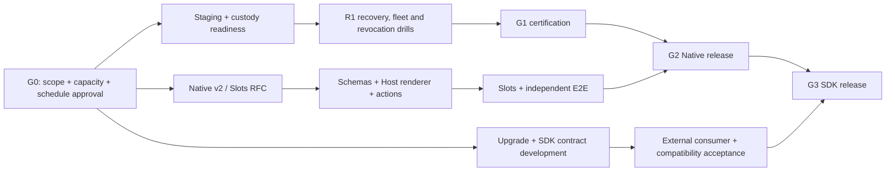

# Vibress Plugin Platform — G0-06 Integrated Schedule, Critical Path and RAID Register

**Document version:** 1.0 (conditional planning baseline)  
**Remote evidence baseline:** `c641ed063f79ceb109988ec19692338a319c8b96`  
**Status:** DRAFT SCHEDULE / RAID FOR APPROVAL; NOT A COMMITTED RELEASE FORECAST  
**Time convention:** Week 0 (W0) = date of formal G0 approval and capacity authorization; no start date has been set.

## 1. Planning model and confidence

This scenario assumes G0-05 confirms approximately 9.25 FTE of protected cross-functional R1–R3 capacity, including 2 backend, 2 frontend, 1 architect, 1 QA, 0.75 security, 0.75 SRE/DB, 0.75 DX and 1 PM. Existing code and operational tooling are reused. R1 staging access and realistic backup data are available by W2, and product scope is frozen at G0. Scope and staffing uncertainty make **calendar-date and cost confidence low**. Relative sequencing confidence is medium.

**Do not add workstream durations linearly:** engineering tracks overlap within the same capacity budget. **Do not treat the overlapping tracks as independently staffed:** see G0-05 allocation controls.

## 2. Integrated milestone and release schedule (illustrative)

| ID | Window | Output and exit condition | Hard dependency | Accountable role |
|---|---|---|---|---|
| M0 | Before W0 | Approved G0-04/05/06, documentation/evidence pack and G0-09 decision | G0 scope, funding, risk approval | Executive Sponsor |
| M1 | W1–W3 | Staging data/profile, secret and signer custody, drill run plan; Native v2 design spikes | M0, SRE/Security availability | SRE / Security Leads |
| M2 | W3–W10 | R1 restore, queue, multi-replica, rotation and revocation drills; defects triaged | M1; G0-07 five operational gaps | Operations Lead |
| **G1** | **Target W12–W14** | Trusted Plugin Foundation operational certification (or HOLD with evidenced blockers) | Passed drills, exact-SHA CI, security & operations sign-off | Designated G1 authority |
| M3 | W3–W9 | Native v2 RFC, version negotiation, bounded component/slot scope, independent fixture design | G0 architecture decisions; design can overlap R1 | Principal Architect |
| M4 | W10–W20 | Native renderer/actions/resources; initial Host-controlled component registry | M3 signed contract; security review | Admin Lead |
| M5 | W17–W26 | Initial Slots, independent plugin UI, Arabic/RTL/a11y and publication-switch E2E | M4 schema/Host admission | Admin Lead / QA Lead |
| **G2** | **Target W28–W30** | Native Experience certified or held; **no release without G1** | G1, M5, Native allowlist and operational evidence | Designated G2 authority |
| M6 | W15–W30 | Upgrade migration/fleet consistency work, typed workflows/events, SDK packaging proposal | R1 controls, public ABI decisions; may develop before G2 | Backend Lead / SDK Lead |
| M7 | W27–W40 | Independent packaged SDK consumer, old/new compatibility, populated upgrades, event idempotency, self-hosted docs | M6; G2 required for supported SDK release | SDK Lead / QA Lead |
| **G3** | **Target W42–W44** | Public developer platform release decision | G2, M7, exact-SHA CI, recovery and security sign-offs | Designated G3 authority |
| M8 | W45–W48 | Conditional stabilization and contingency; do not convert to unchecked scope | Unresolved acceptance defects/change requests | Program Manager |
| R4/R5 | Not scheduled | Security program and later Marketplace business gate | Separate capacity/funding; G4 before G5 | Security / Sponsor |

The ~44–48 week planning envelope is consistent with an upper-range 8–12 month hypothesis, **not** a promise. If G1 is delayed or the team is smaller, reforecast G2/G3 without relaxing acceptance.

## 3. Critical path, dependencies, float and update policy

**Currently critical or near-critical:** staging readiness → successful operational R1 drills → G1 → G2 → G3; independent Native RFC/renderer/slot delivery → G2; upgrade and SDK conformance → G3. Actual float is **unknown** until work-item-level estimates, team calendars, and predecessor links are loaded into the delivery system.

Report forecast weekly (RAG, variance in weeks, next gate blocker, confirmed staffing and actual test evidence); use two-week sprint reviews and monthly steering reviews. Significant slippage triggers a signed reforecast, not a silent date shift.

## 4. RAID register — working baseline

| ID / Type | Description and impact | Likelihood / impact | Trigger / early warning | Response / containment | Accountable owner | State |
|---|---|---|---|---|---|---|
| R-01 Risk | Scarce engineers pulled into unrelated initiatives delay critical path | Medium / High | Allocations unconfirmed, >15% loss in planned capacity | Rebaseline capacity, sequence R1 first, freeze noncritical work | Engineering Manager | Open |
| R-02 Risk | R1 restore/fleet drills expose data loss or unsafe quiescence | Medium / Critical | Restore digest mismatch, dangling queue receipts, uncoordinated replicas | Hold G1, reproduce fault, fix narrowly and rerun drill | Operations Lead | Open |
| R-03 Risk | Native UI v2 becomes unbounded UI DSL | Medium / High | New arbitrary widget/callback requests bypass RFC | Admit components only with concrete use case, schema and tests | Architect | Open |
| R-04 Risk | Plugin update incorrectly marks migration complete or activates mixed fleet | Medium / Critical | Missing runner/failed migration still advances state | Require verified migration evidence and fleet fencing before activation | Backend/DB Lead | Open |
| R-05 Risk | Host Admin executes untrusted plugin code | Low / Critical | JSX/JS/HTML callback or remote module enters Native descriptor | Strict Host-only registry, schema validation, CI negative tests | Security Lead | Open |
| R-06 Risk | SDK publication breaks external clients or V1 content | Medium / High | Failed old/new conformance; new private import | Independent consumer CI and version/deprecation policy | SDK Lead | Open |
| R-07 Risk | Self-hosted staging cannot reproduce production security profile | Medium / High | Missing kernel/Redis/DB/custody capabilities | Define supported profiles; R4 only after environment certification | SRE Lead | Open |
| A-01 Assumption | 9.25 FTE protected capacity granted | Not confirmed | G0-05 unsigned | Treat dates as conditional; re-estimate on actual allocations | Engineering Manager | Unvalidated |
| A-02 Assumption | Populated backup and isolated staging available by W2 | Not confirmed | No safe fixture/custody | Procure before starting R1 acceptance; shift G1 | Operations Lead | Unvalidated |
| A-03 Assumption | Scope limited to approved R1–R3 | Not confirmed | Marketplace/advanced widgets added to sprint | Sponsor/Product change-control decision | Product Owner | Unvalidated |
| I-01 Issue | Live R1 DR/quiescence/rotation/revocation exercises not recorded | Critical | Five gaps explicitly open in G0-07 | Stage, execute, retain logs, obtain G1 approvals | Security + Operations Leads | Open |
| I-02 Issue | Exact current HEAD quality gates not certified by this evidence set | High | CI for baseline not successful at review time | Recheck exact-SHA full CI and attach immutable result | QA Lead | Open |
| I-03 Issue | Formal scope, funding, staffing and schedule approvals absent | High | G0-04/05/06 signatures blank | Collect named human decisions; keep G0 open | Program Manager | Open |
| D-01 Dependency | G1 trusted operational certification required for G2 release | Hard | G1 held | UI development may proceed behind flags; production release cannot | Admin Lead | Open |
| D-02 Dependency | Approved Native v2 schema/slot RFC required before renderer/consumer contracts freeze | Hard | ADR unresolved | Time-box design and obtain API/Security/RTL review | Principal Architect | Open |
| D-03 Dependency | G2 + independent packaged consumer + upgrades required for G3 supported SDK | Hard | Consumer or upgrade acceptance fails | Keep SDK private until gates pass | SDK Lead | Open |
| D-04 Dependency | R4 isolation and distinct commercial approval required for R5 | Hard | G4 unapproved | No untrusted Marketplace release or investment implied | Sponsor / Security Lead | Deferred |

In the tracking system, add numeric risk score and due dates after actual risk appetite, dates and owners are agreed. Do not label a risk 'closed' merely because a document mentions it.

## 5. Decision log and approval package

| Decision ID | Required decision | Owner | Latest safe decision point | Recommendation | Evidence/status |
|---|---|---|---|---|---|
| G0-D01 | Confirm R1–R3 scope, exclusions and business value | Product Owner + Sponsor | Before G0-09 | Approve conditionally, keep R4/R5 separate | G0-04 — Pending |
| G0-D02 | Confirm named 8.5–10 FTE range or rebaseline | Engineering Manager + Sponsor | Before schedule authorization | Use 9.25 FTE planning case only if actually available | G0-05 — Pending |
| G0-D03 | Approve relative schedule, RAID, contingency and change control | PM + Sponsor (approval) | Before G0-09 | Accept conditional schedule after staffing | G0-06 — Pending |
| G0-D04 | Approve initial Native v2 widgets and slots | Principal Architect + Product | Before M4 build freeze | Bounded registry, no arbitrary Admin JS | G0-08 RFC — Pending |
| G0-D05 | Approve staging drill window and handling of sensitive backups | Operations + Security Leads | Before M1 | Use isolated, disposable, access-controlled environment | G1 preparation — Pending |
| G0-D06 | Formal G0 Go/No-Go | Executive Sponsor | After G0-04/05/06 complete | Keep G0 OPEN until evidence complete | G0-09 — Pending |

## 6. G0-06 closure evidence checklist

- [ ] [G0-04](plugin-platform-g0-04-scope-approval.md) approved scope/exclusions and investment policy linked.
- [ ] [G0-05](plugin-platform-g0-05-capacity-ownership.md) signed named owners, actual allocations, alternate coverage, cost envelope linked.
- [ ] Relative schedule converted to calendar dates only after G0 decision and resource calendars confirmed.
- [ ] Each milestone has owner, predecessor, acceptance evidence and measurable gate.
- [ ] RAID entries have named owners, review cadence, triggers and actual due dates.
- [ ] [G0-07](plugin-platform-r1-operational-gap-g0-07.md) live operational gaps explicitly scheduled and linked to G1 evidence collection.
- [ ] Exact-HEAD CI status and approved engineering review evidence linked.
- [ ] Baseline document revision and decision log reviewed by Architect, Security, QA, Operations, Product and Sponsor.
- [ ] [G0-09](plugin-platform-g0-09-executive-decision.md) Go/No-Go minutes record signed decision, scope, schedule, funding and open conditions.

**G0-06 current disposition: PREPARED FOR REVIEW; PENDING ACTUAL OWNER/SCHEDULE/SIGN-OFF.**
