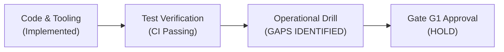
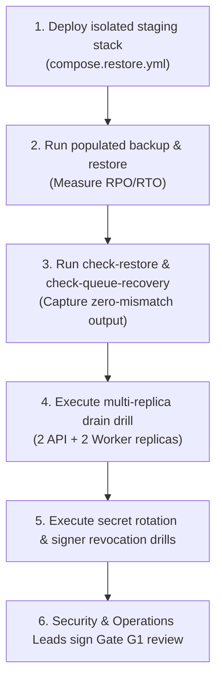

# Plugin Platform — R1 Operational Recovery & Evidence Gap Assessment (G0-07)

**Document Version:** 1.0  
**Evidence SHA:** [`f3cc8c4dee53f8fc243207169f08f22e12bb9177`](../../apps/admin/src/components/PageEditor.tsx)  
**Target Release:** Release R1 (Trusted Plugin Foundation)  
**Execution Date:** November 5, 2026  
**Accountable Roles:** Security Lead & Operations Lead  
**Status:** **Authoritative Gap Assessment (G0-07 Complete)**  
**Prerequisites:** G0-01 (Inventory), G0-02 (Milestone Reconciliation), [`plugin-platform-restore-drill.md`](plugin-platform-restore-drill.md)

---

## 1. Executive Summary

Release R1 (*Trusted Plugin Foundation*) requires operational certification before Gate G1 approval. While the scripts, Docker Compose harnesses, and procedure runbooks are fully implemented in the repository, **live execution evidence has not been recorded**.

This document defines the exact operational gaps that separate R1's current **Implemented / Test-Verified** code status from **Operational Certification** (Gate G1).

---

## 2. Implemented Tooling & Verification Assets

The following operational tools and configurations are present in the repository:

| Asset | File Path | Capability Verified in Code |
|---|---|---|
| **Restore Preflight** | [`scripts/plugins/check-restore.ts`](../../scripts/plugins/check-restore.ts) | Verifies lockfile signature, checksums, enabled publication plugins, and pending receipts without executing code. |
| **Queue Recovery Auditor** | [`scripts/plugins/check-queue-recovery.ts`](../../scripts/plugins/check-queue-recovery.ts) | Reads BullMQ Redis jobs and reconciles them against `plugin_event_receipts` in PostgreSQL during quiescence. |
| **Restore Environment** | [`compose.restore.yml`](../../compose.restore.yml) | Isolated, disposable PostgreSQL + Redis stack for non-destructive restore drills. |
| **Secret Rotation Harness** | [`compose.plugins.secret-rotation.yml`](../../compose.plugins.secret-rotation.yml) | Test stack for secret re-encryption and key-version migration drills. |
| **Signer Revocation Harness** | [`compose.plugins.signer-revocation.yml`](../../compose.plugins.signer-revocation.yml) | Test stack for verifying fail-closed behavior when an Ed25519 signer key is revoked. |
| **Admission Tool** | [`scripts/plugins/admit.ts`](../../scripts/plugins/admit.ts) | Offline CLI for staging, calculating SHA-256 digests, and generating signed release receipts. |

---

## 3. R1 Operational Evidence Gaps

The following five operational exercises must be executed in a dedicated staging environment to produce the required evidence pack for Gate G1:

### Gap 1: Live Staging PostgreSQL & Redis Restore Drill
- **Requirement:** Execute [`scripts/plugins/check-restore.ts`](../../scripts/plugins/check-restore.ts) and [`scripts/plugins/check-queue-recovery.ts`](../../scripts/plugins/check-queue-recovery.ts) against a realistic, populated database backup in [`compose.restore.yml`](../../compose.restore.yml).
- **Required Retained Evidence:**
  - Backup completion timestamp and source database commit SHA.
  - Measured Recovery Point Objective (RPO) and Recovery Time Objective (RTO).
  - SHA-256 digest equality between pre-backup and post-restore plugin records.
  - Zero unledgered or dangling BullMQ Redis jobs.
- **Current Status:** **OPEN / PENDING DRILL EXECUTION**

### Gap 2: Multi-Replica Quiescence and Drain Verification
- **Requirement:** Verify fleet coordination across at least 2 API instances and 2 Worker instances under synthetic background event load.
- **Required Retained Evidence:**
  - Setting `VIBRESS_PLUGIN_RECOVERY_MAINTENANCE=1` halts job consumption without killing active transactions.
  - Quiesced workers drain in-flight jobs gracefully.
  - No duplicate event executions or lost receipts during failover.
- **Current Status:** **OPEN / PENDING DRILL EXECUTION**

### Gap 3: Secret Rotation & Key-Version Compatibility Drill
- **Requirement:** Rotate `VIBRESS_ENCRYPTION_KEY` while encrypted publication settings and secrets exist in migration `0041`.
- **Required Retained Evidence:**
  - Verify that dual-key reading functions properly during the rotation window.
  - Re-encryption migration converts existing ciphertext rows without downtime.
  - Rejection of corrupted or tampered ciphertext with structured audit logging.
- **Current Status:** **OPEN / PENDING DRILL EXECUTION**

### Gap 4: Signer Revocation Fail-Closed Verification
- **Requirement:** Simulate cryptographic signer key compromise using [`compose.plugins.signer-revocation.yml`](../../compose.plugins.signer-revocation.yml).
- **Required Retained Evidence:**
  - Active plugins signed by the revoked key are immediately blocked from execution.
  - Running API and Worker replicas reject subsequent calls fail-closed.
  - Core non-plugin requests (posts, pages, media, auth) remain 100% operational.
- **Current Status:** **OPEN / PENDING DRILL EXECUTION**

### Gap 5: Formal Security & Operations Sign-off
- **Requirement:** Security Lead and Operations Lead inspect retained run logs and sign off on G1 criteria.
- **Current Status:** **OPEN / PENDING DRILL COMPLETION**

---

## 4. Execution Sequence for G1 Closure

---

## 5. Conclusion & Disposition

All prerequisite scripts, schemas, and configurations for R1 operational recovery are **implemented and verified in tests**.

To close the operational evidence gap for Gate G1:
1. Schedule a dedicated staging drill maintenance window.
2. Retain machine logs and timing metrics for Gaps 1–4.
3. Submit the completed drill report for Security and Operations sign-off.

G0-07 is **COMPLETE** as an authoritative gap assessment.
