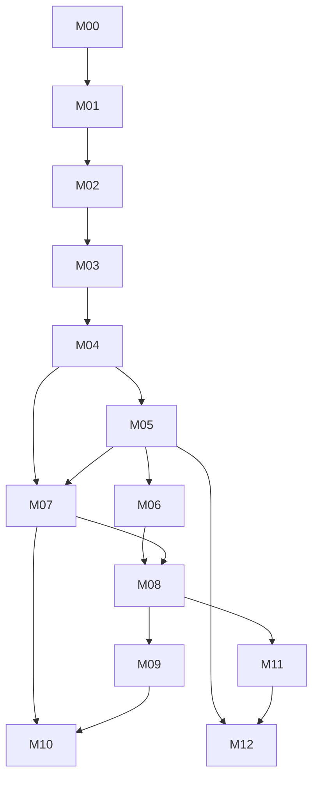

# Milestone Dependencies and Program Risk Register

> **PROPOSED / NOT CERTIFIED** · 2026-11-14 · Based on `main` at `5183f34f0c404de9c02ba8c79cc54b42bc6975e6`.
>
> Planning content only: existence of a document or issue does **not** mean code shipped or production was approved. New `M00–M12` IDs do not replace the existing Plugin Platform `M0–M6` roadmap.

## Dependency graph

**Critical v1 path:** M00→M01→M02→M03→M04→M05/M06/M07→M08. M02 threat-model work can begin M00; M07 docs can begin M03; Visual/AI/Cloud prototypes are not allowed to bypass security or release gates.

| Risk | Severity | Proposed mitigation / evidence |
| --- | --- | --- |
| CMS extraction loses or changes existing content/payments | Critical | additive migrations, pinned fixtures, staging restore and dual-read if needed |
| RLS misconfigured with pooled connections | Critical | same-transaction context test, nonowner role, missing-context deny, pool reuse probes |
| Broad Node plugin privileges exploited | Critical | trusted-only admissions; OS-isolation gate for Tier-2 |
| Generated schema migration destroys data | Critical | preview/approval, expand-contract and data backfill assertions |
| Builder and code-first diverge | High | canonical resource IR and codegen ownership rules |
| AI agent can access prod secrets or permissions | Critical | server-enforced scoped tools, human approval, audit |
| Cloud becomes mandatory and vendor lock-in | High | offline self-hosted conformance and deployment adapters |
| Lexical/Next.js releases break Studio/CMS | High | pinned compatibility matrix and cross-repo fixtures |
| Conflicting roadmap M0-M6 and M00-M12 IDs | Medium | named plan namespace, maintain old source ledger and explicit mapping |
| Scope creep delays first usable framework | High | enforce code-first v1 GA before Wix-style builder and PaaS |

## ADR questions to close in M00/M01

Are app and tenant identities separate across single/multi tenant installations? Which schemas are physical versus dynamic? Which resource operations can be generated and which require handwritten policy? What are the plugin SDK/ABI support windows? How can custom code survive generators? What is permitted to auto-migrate? Can independently developed apps fully self-host without Cloud?

## Relative complexity only

M/L/XL/XXL are qualitative. Team capacity, dates, sprint plans and implementation costs require separate approval; this document contains no promised dates.
