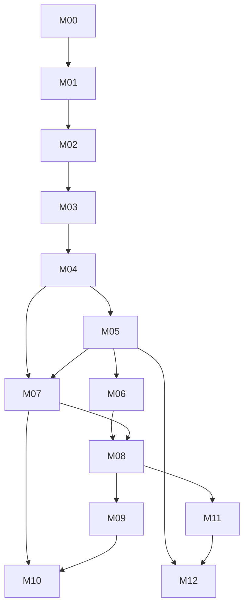

# Milestone Dependencies and Program Risk Register

> **PROPOSED / NOT CERTIFIED** · 2026-11-14 · Based on `main` at `5183f34f0c404de9c02ba8c79cc54b42bc6975e6`.
>
> Planning content only: existence of a document or issue does **not** mean code shipped or production was approved. New `M00–M12` IDs do not replace the existing Plugin Platform `M0–M6` roadmap.

## Dependency graph

**Critical v1 path:** M00→M01→M02→M03→M04→M05/M06/M07→M08. M02 threat-model work can begin M00; M07 docs can begin M03; Visual/AI/Cloud prototypes are not allowed to bypass security or release gates.

| Risk | Severity | Proposed mitigation / evidence |
| --- | --- | --- |
| CMS extraction loses or changes existing content/payments | Critical | additive migrations, pinned fixtures, staging restore and dual-read if needed |
| RLS misconfigured with pooled connections | Critical | same-transaction context test, nonowner role, missing-context deny, pool reuse probes |
| Broad Node plugin privileges exploited | Critical | trusted-only admissions; OS-isolation gate for Tier-2 |
| Generated schema migration destroys data | Critical | preview/approval, expand-contract and data backfill assertions |
| Builder and code-first diverge | High | canonical resource IR and codegen ownership rules |
| AI agent can access prod secrets or permissions | Critical | server-enforced scoped tools, human approval, audit |
| Cloud becomes mandatory and vendor lock-in | High | offline self-hosted conformance and deployment adapters |
| Lexical/Next.js releases break Studio/CMS | High | pinned compatibility matrix and cross-repo fixtures |
| Conflicting roadmap M0-M6 and M00-M12 IDs | Medium | named plan namespace, maintain old source ledger and explicit mapping |
| Scope creep delays first usable framework | High | enforce code-first v1 GA before Wix-style builder and PaaS |

## ADR questions to close in M00/M01

Are app and tenant identities separate across single/multi tenant installations? Which schemas are physical versus dynamic? Which resource operations can be generated and which require handwritten policy? What are the plugin SDK/ABI support windows? How can custom code survive generators? What is permitted to auto-migrate? Can independently developed apps fully self-host without Cloud?

## Relative complexity only

M/L/XL/XXL are qualitative. Team capacity, dates, sprint plans and implementation costs require separate approval; this document contains no promised dates.

## New blockers and risk ownership from PR review

| ID | Risk / design gap | Severity | Gate / required proof | Lead role |
| --- | --- | --- | --- | --- |
| R01 | Unscoped pooled `getDb()` bypasses tenant UoW expectations | Critical | M02 real PG isolation, same connection and pool-reuse matrix | DB + Security |
| R02 | Shared multi-app runtime not isolated by app boundary | Critical design | M00 deployment topology ADR; v1 isolated app installs default | Architecture + Security |
| R03 | Runtime role holds `CREATE public` and broad function grants | Critical | M02 approved staged grants/provisioner migration | DB |
| R04 | Schema compiler produces unapproved SQL/DDL | High | M03 bounded IR, installer policy, destructive-change review | Data platform + Security |
| R05 | CMS `pub_default` copied into new app context | High | M01 additive CMS adapter + no publishing import regression | Platform |
| R06 | Plugin SDK is private and ABI/public SemVer not certified | High | M05/07 packed independent consumer, version matrix | Plugin + Release |
| R07 | Five full Golden Apps inflate v1 scope | High | M00/07 explicit minimum CMS+CRM; others staged | Product |
| R08/R09 | Automatic certification or lossless DB downgrade claimed | High | M08 real decision, RPO/RTO and forward-fix | Release + DB |
| R10/R14 | Control-plane and agent authority confusion | High | M10/11 scoped auth and threat model | Security |
| R16 | Documentation validation and English normativity not defined | Medium | M00 CI docs checks, English authoritative edition | Docs + Release |

For complete evidence and caveats see [PR review findings](REVIEW-FINDINGS-2026-11-14.md). Treat the English master and supporting documents as the **current normative proposed plan**. Earlier translations are informational until synchronized. Existing code fixes are not included in this documentation PR.

## Critical path correction

- **Design-before-build:** M00 ADR-PLAT-001/002/003 must precede M01 runtime deployment; M02 security prototype begins during M00.
- **Minimum GA:** M05 trusted module/runtime subset and M06 transactional event/job subset, not complete marketplace/workflow/billing platforms. M07 requires CMS+CRM mandatory; Real Estate/Booking/Commerce expand later.
- **Separate stop/go:** M08 security/release approval may block v1 even if all Issues are closed. M09–M12 retain independent later security reviews.
