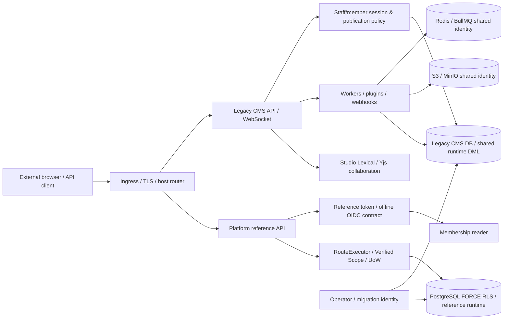

# WAVE-01 THREAT MODEL — Agent 03

> 2026-11-16, PR #166 at `a96ea073767e303b02121d87558adbd12ce111f3`. STRIDE-style design assessment; attack paths are hypotheses unless backed by the confirmed source observations indicated. No active attacks performed.

## Assets

Publication and tenant content; staff/member accounts, sessions and invitation grants; API/plugin credentials and IdP tokens; PostgreSQL CMS/platform tables, views, secrets and migrations; Lexical/Yjs documents; media objects, signed URLs and backups; Redis caches, queues, jobs and outbox; customer metadata and audit logs; build/publish artifacts.

## Trust-boundary graph

The platform reference's verified runtime contract **does not** wrap the legacy API/worker. Network edge, operator DB, plugin runtime, external storage and queue identity are distinct trust boundaries; tenant IDs inside HTTP headers or job payloads are untrusted until resolved server-side.

## Threat actors and concrete paths

| Actor / entry | Candidate attack path and mitigations | Impact / priority | Evidence status |
| --- | --- | --- | --- |
| External attacker / API client | Alter publication/customer IDs (BOLA), forged tenant header, cookie CSRF, JWT substitution; require session, object authorization, verified scope and RLS | Cross-tenant read/write P1 | Reference controls read; full CMS route negatives pending |
| Malicious tenant/member | Join foreign Yjs room or use document/file ID, sharing/export path, webhook callback | Data disclosure or corruption P1 | Studio fixture coverage reported; direct websocket replay pending |
| Compromised legacy runtime credential | Direct SQL over `vibress_app` broad CMS DML or CREATE; bypass HTTP publication filter | Multi-publication compromise P1 | Confirmed broad grant source; no live compromise simulated |
| Compromised plugin/extension | Call owner-privileged endpoints, create plugin storage, access unscoped DB/queue, SSRF | Privilege expansion P1 | Sandbox and DB authority need review |
| Rogue worker / queue job | Supply another tenant in message payload and retry/idempotency key; use shared Redis ACL or shared S3 credential | Cross-tenant writes, duplicate sends P1 | Shared client source confirmed; deny matrix not executed |
| Unauthorized admin/staff | Role ceiling bypass, invitation to different publication, access analytics/exports | P1 | Earlier F-002/F-004 tests reported, independently unverified |
| Token/session attacker | Static bearer token reuse, forged `kid` or issuer, revoked member session, cross-installation token | Account takeover P1 | Offline verifier reviewed, production IdP not wired |
| Installation A compromised | Reuse Redis/MinIO/queue identity to reach installation B | Cross-installation leak P1 | W1-T06 identifies no real deny proof |
| Database/privileged owner | Superuser bypasses RLS; non-`security_invoker` view or `SECURITY DEFINER` indirect authority | All tenant data P0/P1 | R35 scoped view test source, R26 grants open |
| Supply-chain/deployment attacker | Compromised CI action, vulnerable dependency, artifact swap or lock drift | Code execution/availability P1/P2 | Fastify 5.12.7 and conditional GHSA confirmed; full SBOM pending |

## Control objectives / required negative tests

- Deny same token across installation and application bindings, expired/unknown key and revoked membership.
- Deny foreign tenant/customer/role/document/media IDs at every HTTP, websocket, plugin and worker entry.
- Deny runtime direct SQL without a tenant scope, forbidden role switch, view without `security_invoker`, materialized and foreign tables.
- Deny Redis cross-prefix commands, BullMQ foreign queue and S3 foreign objects with actual low-privilege identities.
- Deny plugin raw SQL, unsafe webhooks/SSRF, account role promotion and CSRF-protected mutations.
- Verify R26 functions under real legacy and platform roles after policy change; never self-approve the grant revocation.
- Validate exact build, dependencies and CI provenance and restore drills before release.

## Sources accessed 2026-11-16

[OWASP API Top 10 2023](https://api-security.owasp.org/editions/2023/en/0x11-t10/); [OWASP Authorization](https://cheatsheetseries.owasp.org/cheatsheets/Authorization_Cheat_Sheet.html); [PostgreSQL 16 RLS](https://www.postgresql.org/docs/16/ddl-rowsecurity.html); [NIST SP 800-218](https://csrc.nist.gov/pubs/sp/800/218/final).

## Integrated risk update — 2026-11-16 (PR #176)

- **OIDC → policy trust-boundary mismatch (AG03-07):** an IAM adapter that returns a server-confirmed tenant but no principal permissions is denied by `PolicyEngine` even if `RouteExecutor` finds an active grant. Proposed code change hydrates only trusted membership grants and RouteExecutor independently re-resolves and checks current membership. Test forged JWT wildcard and removal between verification and execution; new code needs Agent 05 and Agent 06 review.
- **Worker / Queue / DB permission disagreement (AG03-08/09):** Agent 04's 38-case ACL lab proves disposable primitives but not the actual BullMQ process identity, while Agent 02's 7-role topology is target design and integrated provisioning manages only three roles. An attacker with a legacy worker credential can still reach a broad CMS SQL surface; no production deployment claim.
- **Fastify conditional DoS:** streamed media response exists; nonzero handlerTimeout was not observed on the two serving Fastify constructors. Explicit 0 and source guard proposed; fixed >=5.12.8 recommended. Threat is availability, not data leakage. See [Fastify disposition](FASTIFY-ADVISORY-DISPOSITION-2026-11-16.md).
- **R35:** contract blocks foreign/materialized sources, but SECURITY DEFINER, views and reporters outside the platform runtime require independent catalog proofs. See [R35 verification](R35-INTEGRATED-APPSEC-VERIFICATION.md).

No new remote exploit was performed and no live production identity was accessed. All conclusions above are source analysis, not execution evidence.
